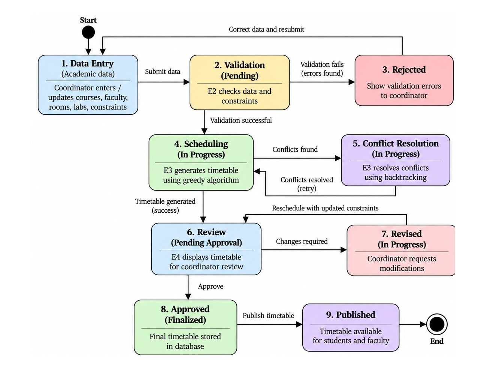

# Constraint-based-timetable 
Constraint-Based Academic Timetable Generation  System
Academic Timetable Generation System

Project Overview

Class Sync is a constraint-based academic timetable generation system designed to simplify the process of preparing college timetables. It aims to reduce manual effort, prevent scheduling conflicts, and improve the accuracy of timetable preparation.

The system manages academic information, validates scheduling constraints, generates timetable assignments, and provides a facility for reviewing and approving the final timetable.

Objectives

Automate academic timetable generation.

Validate faculty, classroom, and laboratory availability.

Detect and resolve scheduling conflicts.

Support division-wise and batch-wise timetable allocation.

Allow coordinators to review, revise, and approve generated timetables.

Generate timetable reports for academic use.

Main Engines

E1 – Academic Data Management: Manages courses, faculty, rooms, laboratories, divisions, batches, and time slots.

E2 – Constraint & Validation: Validates academic data and checks scheduling constraints.

E3 – Scheduling & Conflict Resolution: Generates timetables using a greedy algorithm and attempts conflict resolution using backtracking.

E4 – Timetable Review & Visualization: Displays generated timetables, supports review and revision, and facilitates approval and publication.

Key Features

Academic data management

Faculty and room availability checks

Scheduling constraint validation

Timetable generation

Conflict detection and resolution

Division-wise and batch-wise timetable viewing

Timetable review and approval

Report generation

Technologies and Algorithms

The planned scheduling approach includes greedy scheduling for initial timetable generation and backtracking for resolving conflicts. The implementation technologies and database design will be documented as development progresses.

Project Scope

The initial scope focuses on timetable preparation for the CSE department, including academic data management, scheduling constraints, conflict resolution, and timetable review.

Project Status

Currently in the solution-design and development-planning phase. Architecture diagrams, engine interactions, workflow diagrams, and design documentation are being prepared as part of Sprint 1.

Team Contributions

The project is divided into four engines, with each team member responsible for the design and development of an assigned technical component.

## Project Diagrams

### 1. Academic Scheduling System Architecture

  

### 2. Academic Timetable Generation Flowchart

  

### 3. Algorithm Flowchart

  

### 4. API Flow

  

### 5. E1 - Academic Data Management

  

### 6. E2 - Constraint and Validation Architecture

  

### 7. E3 - Scheduling Architecture

  

### 8. E4 - Timetable Review and Visualization

  

### 9. Database ER Diagram

  

### 10. Engine Dependencies

  

### 11. Timetable Generation and Review Sequence

  

### 12. Timetable State Diagram

  

